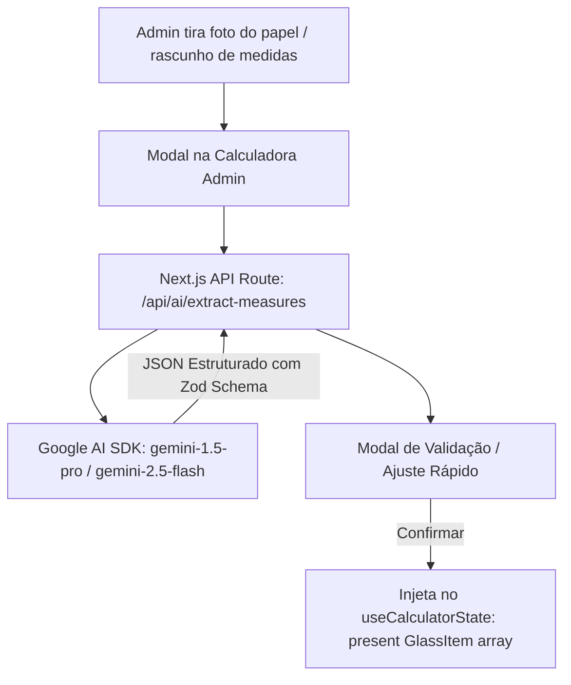

# 🤖 Roadmap de Inteligência Artificial para a Calculadora Admin (LUME)

> **Documento Estratégico:** Integração do Google AI (Gemini Pro / Multimodal) na Calculadora Admin e no Fluxo de Corte de Películas.
> **Versão:** 1.2.0  
> **Status Geral:** Opções A, C e D 100% Concluídas e Operacionais ✅

---

## 📊 Matriz de Status do Roadmap

| Opção | Funcionalidade | Modelo | Status |
| :--- | :--- | :---: | :---: |
| **Opção A** | Leitura Automática de Medições por Foto/Câmera | Gemini 3.8 Flash | ✅ **Concluída** |
| **Opção D** | Entrada Rápida via Áudio (Microfone/Zap) e Texto Livre | Gemini 3.8 Flash | ✅ **Concluída** |
| **Opção C** | Consultor Estratégico de Bobinas & Retalhos (Bluetech) | Gemini 3.8 Flash | ✅ **Concluída** |
| **Opção B** | Copiloto de Corte Narrativo de Bancada | Gemini 3.8 Flash | ⏸️ *Pausada (sob demanda)* |

---

## 🎯 1. Visão Geral e Princípio Arquitetural

O mapa de corte de películas é um problema de **Otimização Combinatorial Geométrica (2D Guillotine Strip Packing)**. 
- **O que a matemática determinística faz:** Cálculo milimétrico de coordenadas $(X, Y)$, margem de segurança de corte e rotação de peças (`src/workers/packer.worker.ts`).
- **O que o Google AI (Gemini Pro) faz:** Processamento de linguagem natural, visão computacional multimodal (OCR inteligente), geração de instruções de bancada e inteligência de negócios/sobras.

---

## 🗺️ 2. As 4 Frentes de Integração com Google AI

### 📸 Opção A & D: Central Multimodal de Medidas (Foto, Texto e Voz)
> **Status: 100% Implementado e Operacional ✅**

- **Foto / Câmera:** Leitura de pranchetas, papéis manuscritos, fitas adesivas e prints com compressão no client.
- **Texto Livre:** Colar mensagens do WhatsApp, e-mails ou anotações digitadas.
- **Áudio & Microfone:** Gravação de voz direta no navegador com MediaRecorder ou upload de arquivos de áudio do WhatsApp (`.ogg`, `.mp3`, `.m4a`).
- **Acúmulo Contínuo:** Botão `[🎙️ Falar Mais]` para ditar vários áudios picados e ir somando à lista antes de confirmar.
- **Auto-Preenchimento de Cliente:** Reconhecimento automático do Nome do Cliente, Bairro e Telefone (preenchendo os dados da calculadora).
- **Haptic Feedback:** Vibração tátil no celular ao iniciar e finalizar gravações.
- **Validação:** Tabela editável comparando foto/áudio/texto com as peças extraídas antes da injeção no corte.

---

### 🎙️ Opção B: Roteiro Narrativo de Bancada ("Copiloto do Cortador")
> **Status: Pausada temporariamente (sob demanda futura) ⏸️**

- **Problema:** Olhar o desenho vetorial na tela do celular ou computador enquanto está segurando a lâmina e o esquadro na bancada de 1,52m gera pausas e dúvidas sobre qual corte fazer primeiro.
- **Solução com Gemini Pro:**
  1. O resultado do empacotador (`packer.worker.ts`) é transformado em sequência lógica de cortes guilhotina.
  2. O Gemini gera um script de bancada direto e sem rodeios:
     - *"1º Puxe: 2,15m de bobina e corte transversal reto."*
     - *"2º Tira 1: Retire 2 folhas de 1,00m x 2,15m (Varanda)."*
     - *"3º Sobra: A faixa de 52cm x 2,15m deve ser guardada para a Janela da Cozinha."*
  3. Suporte a áudio (Text-to-Speech) ou impressão de etiquetas de bancada.

---

### 💡 Opção C: Consultor Estratégico de Bobinas & Sobras Úteis (Catálogo Bluetech)
> **Status: 100% Implementado e Operacional ✅**

- **Trava de Catálogo Bluetech:** Apenas películas da família **Nano Cerâmica** (`nano_ceramica`, `nano_ceramica_g20`) recebem a sugestão de troca para bobina de 1,00m. As demais linhas (Carbono G5/G20, Refletivas, Dupla Camada, Jateado) são travadas em 1,52m para evitar alucinações de compra.
- **Simulação Matemática em Tempo Real:** Se for Nano Cerâmica, o algoritmo simula o corte em 1,00m vs 1,52m instantaneamente, calculando ganho de eficiência em % e economia estimada em R$.
- **Botão de Ação em 1 Clique:** `[Mudar para Bobina de 1,00m]` ou `[Mudar para 1,52m]` aplica a troca e recalcula todo o mapa de corte.
- **Detecção de Retalhos Nobres:** Identifica sobras limpas contínuas (ex: largura >= 35cm x comprimento >= 80cm) e sugere aplicações alternativas (basculantes, pequenos reparos ou uso automotivo).

---

### ✍️ Opção D: Entrada Rápida via Áudio / Texto Livre
> **Status: 100% Implementado e Operacional ✅ (Unificado com Opção A)**

- **Solução Entregue:** Integrado diretamente no modal `AiVisionModal.tsx` com:
  - Aba de **Texto Livre**: para colar mensagens de WhatsApp ou e-mails com conversão automática de unidades.
  - Aba de **Áudio**: gravação ao vivo via microfone com haptic feedback e upload de `.ogg`, `.mp3` do Zap.
  - Botão **`[+ Mais IA]`** e **`[🎙️ Falar Mais]`**: para acúmulo contínuo de várias mensagens ou áudios picados antes de confirmar.

---

## 🏗️ 3. Arquitetura Técnica Recomendada para a Opção A



### Contrato de Dados (JSON Schema)
```typescript
interface ExtractedGlassDraft {
  ambiente: string;       // Ex: "Varanda Gourmet"
  larguraMm: number;      // Convertido para mm ou cm padrão
  alturaMm: number;       // Convertido para mm ou cm padrão
  quantidade: number;     // Ex: 4
  peliculaSugerida?: string; // Ex: "Nano Cerâmica 75"
  observacoes?: string;   // Ex: "Vidro temperado com puxador"
  confianca: 'alta' | 'media' | 'baixa';
}
```

---

## 🛡️ 4. Protocolo de Segurança e Custos
1. **Chave de API:** Nunca expor a chave do Google AI no frontend (`NEXT_PUBLIC_`). Usar variável de ambiente de servidor `GEMINI_API_KEY`.
2. **Custo:** Com o plano Pro / cota gratuita do Google AI Studio, o custo por requisição multimodal em Flash/Pro é de frações de centavo ou gratuito dependendo da cota mensal.
3. **Privacidade:** Nenhuma foto de medição é persistida no servidor após o processamento (stateless).

